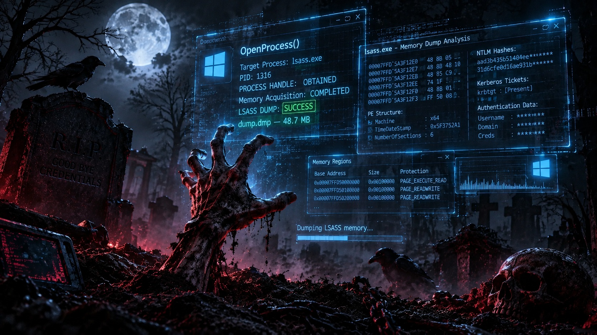

# 💀 GraveMemory

<p align="center">
  
</p>

<p align="center">
  <strong>Windows SAM Credential Auditing Tool</strong>
  <br>
  <em>Understand the secrets behind the Windows Security Account Manager.</em>
</p>

<p align="center">
  
  
  
  
</p>

---

## 🧬 Overview

**GraveMemory** is a Windows SAM credential-auditing tool written in C, built as a from-scratch implementation of the classic two-stage remote-agent architecture.

It uses a launcher and an in-process DLL to perform SAM account enumeration through the Windows SAMR interface.

Unlike the legacy design, GraveMemory intentionally removes the output-encryption layer, including RSA-2048, AES-256-CBC, public-key patching, and anti-debug mechanisms.

The original record-stream format remains byte-compatible.

> ⚠️ **AUTHORIZED USE ONLY**
>
> Designed exclusively for security auditing on systems you own or have explicit written authorization to assess. Credential material must be handled securely.

---

## ⚙️ Architecture & Workflow

GraveMemory follows a two-stage architecture:

```text
       ┌──────────────────────────────┐
       │       gravememory.exe        │
       │          Launcher            │
       └──────────────┬───────────────┘
                      │
                      ▼
             SetAccessPriv
           (SeDebugPrivilege)
                      │
                      ▼
             OpenProcess(LSASS)
                      │
                      ▼
          Remote Execution Pipeline
                      │
                      ▼
       ┌──────────────────────────────┐
       │   gravememorydll64.dll       │
       │   gravememorydll32.dll       │
       │                              │
       │       SAMR Interface         │
       └──────────────┬───────────────┘
                      │
                      ▼
               SAM Account Data
                      │
                      ▼
             Plaintext Record Stream
                      │
                      ▼
               gravememory.dmp
```

### 🔍 Why LSASS?

The local SAM database is accessed through Windows security components hosted within LSASS.

A standalone SYSTEM service cannot simply call the relevant SAMR functionality and expect the same access context. The architecture therefore uses an in-process component.

---

## 🔐 Privilege Handling

The launcher selects its execution path based on the current security context.

| Execution Context | Behavior |
|---|---|
| 🛡️ SYSTEM | Uses the SYSTEM execution context directly |
| 👑 Administrator | Creates a temporary `GraveMemory-XXXXXXXX` service and executes under SYSTEM |
| 👤 Unprivileged | Requests UAC elevation through `ShellExecuteEx` using `runas` |

The temporary service is stopped and deleted after the operation.

---

## 📁 Project Structure

| File | Description |
|---|---|
| `gravememory.c` | Main launcher, UAC handling, service management, result collection and console interface |
| `gravememory_core.c` | In-process component and SAMR-related account enumeration implementation |
| `gravememory_record.c` | Platform-independent record-stream writer and report builders |
| `gravememory_record.h` | Record format definitions and serialization interfaces |
| `gravememory_shared.h` | Shared definitions, remote argument structures, ACL helpers and logging utilities |

---

## 🛠️ Build Instructions

GraveMemory supports both MSVC and MinGW build environments.

### MSVC

```bat
build\build-msvc.bat
```

### MinGW

```bash
bash build/build-mingw.sh
```

### Runtime Dependencies

The following DLL files must be located next to the executable:

| File | Architecture |
|---|---|
| `gravememorydll64.dll` | 64-bit Windows |
| `gravememorydll32.dll` | 32-bit Windows |

---

## 🚀 Usage

### Command Syntax

```cmd
gravememory.exe [--out <folder>] [--wait <seconds>]

gravememory.exe --svc <folder> --svcname <name>

gravememory.exe --help
```

### Available Options

| Option | Description |
|---|---|
| `--out <folder>` | Output directory (default: current directory) |
| `--wait <seconds>` | Maximum waiting period (default: 300 seconds) |
| `--svc <folder>` | Internal service execution mode |
| `--svcname <name>` | Internal service name |
| `--help`, `-h` | Display help information |

### 🖥️ Console Interface

GraveMemory displays a red ASCII banner when launched.

- UTF-8 console output (Code Page 65001).
- Block-art banner and formatted reports.
- Plain-text fallback when standard output is redirected.

---

## 📦 Output Files

All generated files are stored in the directory specified by `--out`.

| File | Description |
|---|---|
| `gravememory.dmp` | Plaintext binary record stream |
| `gravememory.dmp.status` | 12-byte execution status structure |
| `gravememory.dmp.result` | Launcher-to-component result information |
| `gravememory.dmp.log` | Diagnostic and execution log |
| `gravememory.json` | Human-readable JSON report |
| `hashes.txt` | Pwdump-style account records |

### 🔒 File Permissions

The output-file ACL configuration follows the original design:

- **SYSTEM:** Full Control
- **Administrators:** Read + Delete

Implemented through `GM_CreateSecureFile`.

---

## 🧩 Record Stream Format

The record-stream format is documented in `gravememory_record.h`.

It is maintained byte-compatible across versions to support the existing Python parser.

### Record Structure

```text
RECORD #0
└── Domain
    └── [u32 byte_length]
    └── [UTF-16LE data + NUL]

PER USER RECORD
│
├── Username          [u32 length + data]
├── Fullname          [u32 length + data]
├── Admin Comment     [u32 length + data]
├── Home Directory    [u32 length + data]
│
├── RID               [u32 LE]
│
├── NT Present        [u8]
├── NT OWF             [16 bytes, if present]
│
├── LM Present        [u8]
├── LM OWF             [16 bytes, if present]
│
├── Password Last Set [u64 LE / FILETIME]
│
├── Locked Out        [u8]
├── Disabled          [u8]
├── Never Expires     [u8]
└── Expired           [u8]
```

**Protocol Compatibility**

The user-record field order follows `MS-SAMR 2.2.7.23`:

- NT OWF block comes first.
- LM OWF block comes second.

This ordering has been verified against Impacket's `samr.py` and real SAM dump structures.

### 🐍 Parsing

The companion Python parser can process the generated record stream:

```bash
python3 gm_dump_parser.py <folder>/gravememory.dmp
```

The parser automatically detects plaintext dumps. The `--plain` option can be used to explicitly force plaintext parsing.

---

## 🧠 Technical Implementation

### Remote Execution Architecture

The implementation includes the following architectural characteristics:

- Position-independent remote stub.
- Remote argument block using `GM_REMOTE_ARGS`.
- Runtime DLL loading and export resolution.
- Multiple thread-creation fallback mechanisms.
- Remote memory lifetime management.
- Explicit execution status reporting.

### Thread Creation Fallbacks

The implementation includes the following fallback sequence:

```text
CreateRemoteThread
       │
       ▼
RtlCreateUserThread
       │
       ▼
NtCreateThreadEx
```

### Stub Exit Codes

| Exit Code | Meaning |
|---|---|
| `0x00000000` | Success |
| `0xFFFFFFFE` | Invalid arguments |
| `0xFFFFFFFF` | LoadLibraryW failed |
| `0xFFFFFFFC` | GetProcAddress failed |

### Compatibility Notes

The project also contains a legacy Windows 7 / Windows Server 2008 R2 compatibility workaround associated with KB3149090.

---

## 📊 Account Record Information

Each account record represents the following information:

| Field | Description |
|---|---|
| Username | Account name |
| Full Name | Account display name |
| Admin Comment | Administrative description |
| Home Directory | Configured home directory |
| RID | Relative Identifier |
| NT Hash | 16-byte NT OWF value, if present |
| LM Hash | 16-byte LM OWF value, if present |
| Password Last Set | FILETIME timestamp |
| Locked Out | Account lockout status |
| Disabled | Account disabled status |
| Never Expires | Password expiration flag |
| Expired | Account expiration flag |

### Empty Password Markers

The report generator recognizes well-known OWF markers:

| Hash | Meaning |
|---|---|
| `aad3b435b51404eeaad3b435b51404ee` | Empty LM hash marker |
| `31d6cfe0d16ae931b73c59d7e0c089c0` | Empty NT password marker |

### JSON Reporting

The generated `gravememory.json` report provides:

- Pretty-printed UTF-8 JSON.
- Domain information.
- Account metadata.
- Password-related record fields.
- `records_complete` flag to identify incomplete reports.

---

## 📝 Diagnostics & Error Handling

GraveMemory includes structured diagnostic reporting.

- Explicit failure reporting through `gravememory.dmp.result`.
- Diagnostic log output through `gravememory.dmp.log`.
- Launcher-side log-tail display on failure.
- Win32 error-code reporting.
- Timeout detection.
- Explicit reporting for missing runtime DLLs and failed initialization stages.

The launcher treats the service's `STOPPED` state as authoritative when determining completion.

---

## 🗑️ Removed Legacy Components

GraveMemory intentionally removes several components from the original architecture.

| Removed Component | Description |
|---|---|
| RSA Public-Key Patching | Legacy key-sealing mechanism |
| OpenSSL EVP_Seal | RSA/AES encrypted output container |
| AES-256-CBC | Output encryption layer |
| Anti-Debug Loop | Legacy anti-debugging mechanism |

**Design Decision:** GraveMemory keeps the record-stream compatibility while removing the legacy encryption and anti-debugging layers. No external cryptographic libraries are required.

---

## ⚠️ Disclaimer

GraveMemory is intended exclusively for legitimate security auditing, research, and authorized testing of systems owned by the user or covered by explicit permission.

Unauthorized access, credential extraction, or misuse of this software may violate applicable laws.

The authors accept no responsibility for unauthorized or unlawful use of this project.

**Use responsibly. Handle credential material securely.**